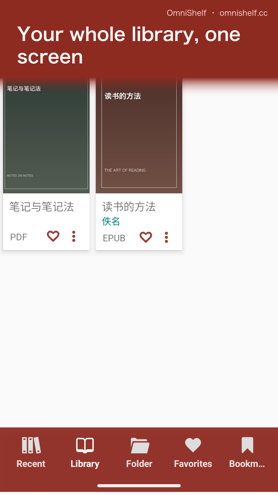
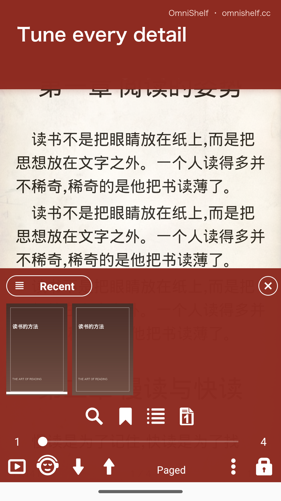
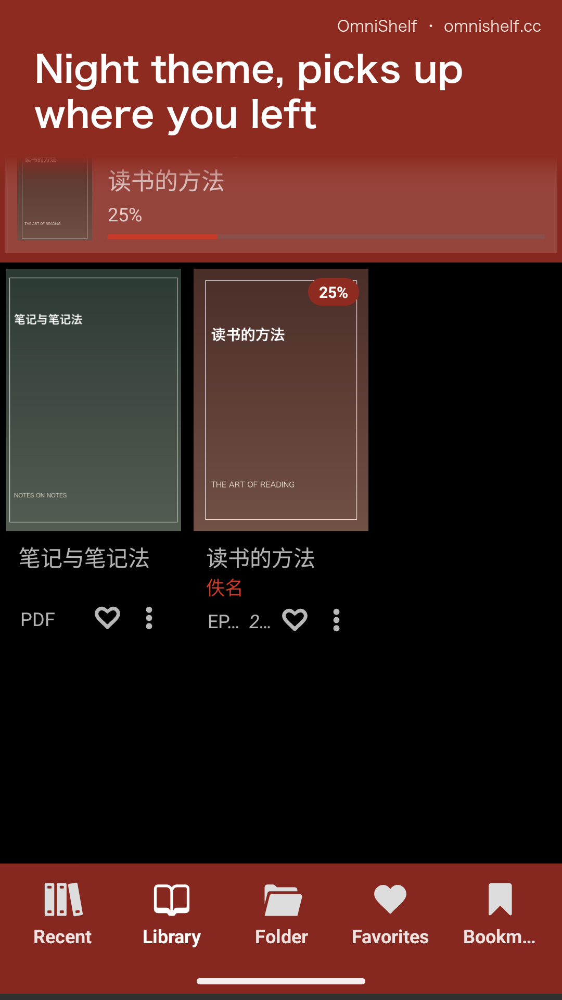

# OmniShelf

**A free, open-source ebook reader for Android. No ads. No tracking. Everything unlocked.**

[](LICENSE)
[](#requirements)
[](#languages)
[](#what-it-does-not-do)

  

**Download:** [Google Play](https://play.google.com/store/apps/details?id=cc.omnishelf.reader) · [APK from Releases](https://github.com/tt7247129-sys/omnishelf/releases) · [Website](https://omnishelf.cc)

---


## What it reads

34 file types: PDF, XPS, EPUB, MOBI, AZW/AZW3/AZW4, FB2, PDB, PRC, DJVU,
CBZ, CBR, DOCX (Android 8+), DOC, ODT, RTF, Markdown, TXT, HTML, XHTML, MHT,
JSON, ZIP.

## What it does

- Day, night, sepia and custom themes
- Fine control over font, margins, line spacing, alignment
- Single page, two page and scrolling modes
- Text-to-speech using the device's built-in voice — works offline
- Highlights, notes and bookmarks
- OPDS catalogs
- Library shelves, tags and search

## Languages

The interface is translated into **54 languages** and follows the system language,
including complete Simplified and Traditional Chinese translations.

## What it does not do

- No advertising SDK, no analytics, no crash reporting
- No account, no sign-in, no cloud sync, no telemetry
- No data leaves the device except for network requests you initiate
  (opening an OPDS catalog, downloading a book) — those go directly from
  your device to that server

See [PRIVACY.md](PRIVACY.md).

---

## Building

The build is non-trivial: PDF rendering is MuPDF, compiled from source for four ABIs.
There are no prebuilt `.so` files in this repository.

### Requirements

| | |
|---|---|
| JDK | 21 |
| Gradle | 9.7.1 (use the bundled wrapper) |
| Android Gradle Plugin | 9.4.1 |
| compileSdk / targetSdk / minSdk | 37 / 36 / 24 |
| NDK | required for the native libraries |
| Disk | ~8–10 GB for the MuPDF tree and four ABI builds |

### 1. Signing properties

`app/build.gradle` reads four bare Gradle properties at **configuration** time,
so they must exist even if you only want to run `./gradlew tasks`:

```properties
# ~/.gradle/gradle.properties
RELEASE_STORE_FILE=/absolute/path/to/upload.jks
RELEASE_STORE_PASSWORD=...
RELEASE_KEY_ALIAS=...
RELEASE_KEY_PASSWORD=...
```

Create a keystore if you do not have one:

```bash
keytool -genkeypair -v -keystore ~/.android/omnishelf-upload.jks \
  -alias omnishelf -keyalg RSA -keysize 4096 -validity 10000 -storetype PKCS12
```

Never commit a keystore. `.gitignore` already excludes `*.jks` and `*.keystore`.

### 2. Native libraries (MuPDF and friends)

```bash
bash Builder/link_to_mupdf_1.28.5.sh
```

This clones Artifex MuPDF 1.28.5, runs `make generate` / `make release`,
builds `armeabi-v7a`, `arm64-v8a`, `x86` and `x86_64` with `ndk-build`,
and symlinks the results into `app/src/main/jniLibs`.

### 3. Build

```bash
./gradlew :app:assembleProRelease     # APK
./gradlew :app:bundleProRelease       # AAB for Google Play
```

Only the `pro` product flavour is published. The other flavours in
`app/build.gradle` are inherited from upstream; some of them bundle AdMob.

---

## License

OmniShelf is free software under the **GNU AGPLv3**, because it links MuPDF,
which Artifex licenses under the AGPLv3 or a commercial license. The complete
corresponding source for every release is this repository.

- [LICENSE](LICENSE) — AGPLv3
- [LICENSE-GPL-3.0.txt](LICENSE-GPL-3.0.txt) — GPLv3
- [NOTICE.md](NOTICE.md) — attribution and statement of changes

### A note on "free"

"Free" here means free of charge *and* free as in freedom. It does **not** mean
restricted: you may use OmniShelf at work, in a business, in a school or in a
library. The AGPL guarantees that. This is a community project, not a business.

---

## Attribution

OmniShelf is an independent fork of the open-source
[Librera Reader](https://github.com/foobnix/LibreraReader) project by Ivan Ivanenko
and contributors. It is **not** the official Librera app and is not affiliated with,
endorsed by, or sponsored by its author. The license they chose is what makes a
project like this possible.

Upstream's original notice is preserved verbatim in
[LICENSE-LIBRERA-NOTICE.txt](LICENSE-LIBRERA-NOTICE.txt).

---

## Links

- Website: https://omnishelf.cc
- Privacy policy: https://omnishelf.cc/privacy
- Issues: https://github.com/tt7247129-sys/omnishelf/issues
